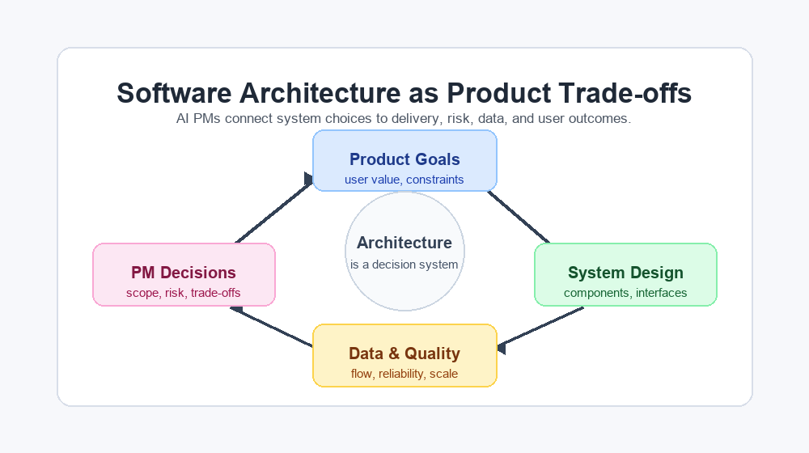

# Architecture Foundations

Software architecture describes how a system is organized so it can deliver a
product experience under real constraints. For a Product Manager, architecture
is not about memorizing every framework. It is about understanding the shape of
the system well enough to ask useful questions, anticipate trade-offs, and make
better product decisions with engineering partners.



Architecture connects four questions:

- What product experience are we trying to deliver?
- Which components are responsible for which work?
- How does data move through the system?
- Which quality attributes matter most: speed, reliability, scalability,
  privacy, cost, maintainability, or compliance?

## Core Vocabulary

| Term | PM-friendly meaning |
|---|---|
| Component | A part of the system with a clear responsibility, such as frontend, API, database, queue, model service, or analytics pipeline. |
| Frontend | The part a person sees and uses in a browser or app: screens, forms, buttons, and feedback messages. |
| API | A defined way for one software component to ask another component for work or data. In this activity, the frontend asks the booking system to list rooms or create a booking. |
| Database | Persistent storage organized so the application can create, read, update, and query information. In this activity, it stores rooms and confirmed bookings. |
| Interface | The contract between components: API endpoint, event schema, database table, file format, or human process. |
| Dependency | Something a feature needs in order to work, such as another service, a team, a vendor, data access, or infrastructure. |
| Data flow | The path data takes from user action to processing, storage, analytics, monitoring, and product feedback. |
| Non-functional requirement | A quality expectation such as latency, uptime, privacy, security, accessibility, scalability, or cost. |
| Technical debt | A design or implementation compromise that may slow future delivery or increase operational risk. |
| Observability | The ability to understand system behavior through logs, metrics, traces, alerts, and dashboards. |
| Architecture Decision Record | A short document explaining an important technical decision, context, alternatives, and consequences. |

## Common Architecture Styles

No architecture style is automatically good or bad. Each style is a trade-off.

| Style | What it means | Product advantage | Product risk |
|---|---|---|---|
| Layered architecture | UI, business logic, and data access are separated into layers. | Easy to explain and onboard. | Can become rigid if every change crosses many layers. |
| Monolith | One deployable application contains most product logic. | Fast early development, simpler local reasoning. | Scaling teams and deployments can become harder. |
| Modular monolith | One deployable application with strong internal module boundaries. | Keeps deployment simple while improving ownership. | Boundaries need discipline or the system drifts. |
| Microservices | Many independently deployable services own specific capabilities. | Teams can scale ownership and release independently. | More operational complexity and distributed dependencies. |
| Event-driven | Components communicate through events rather than direct calls only. | Useful for async workflows, integrations, and analytics. | Debugging and data consistency can be harder. |
| Serverless | Cloud-managed functions or services run code on demand. | Reduces infrastructure management for some workloads. | Vendor lock-in, cold starts, and local testing complexity. |

## PM Implications

Architecture affects product work in practical ways:

- **Delivery speed:** A feature touching one module is easier to ship than a
  feature crossing five services and three teams.
- **Scope quality:** Architecture reveals hidden requirements such as
  permissions, data retention, monitoring, migrations, and rollback plans.
- **Risk management:** Reliability, privacy, and compliance risks often live in
  data flows and interfaces.
- **Analytics readiness:** Product metrics depend on events, data models, and
  trustworthy pipelines.
- **AI readiness:** AI features need accessible data, evaluation loops,
  monitoring, feedback capture, and clear responsibility boundaries.

## Activity: Map a Simple Feature

Choose a familiar product feature, such as "user uploads a profile picture" or
"customer receives a delivery notification".

Write one sentence for each prompt:

1. Which user action starts the flow?
2. Which frontend component collects the input?
3. Which backend component receives it?
4. Where is the data stored?
5. Which logs, metrics, or alerts would help the team notice a problem?
6. Which PM concern could appear: privacy, reliability, performance, cost, or
   user trust?

<details>
<summary>Show example</summary>

Feature: a customer receives a delivery notification.

1. The customer places an order and the delivery status later changes.
2. The mobile app displays the delivery status and notification settings.
3. The order service receives status updates from the logistics partner.
4. The order database stores current status, while an event stream sends
   notification events.
5. The team monitors notification delay, failed sends, partner API errors, and
   customer support contacts.
6. PM concerns include reliability, user trust, opt-in consent, and avoiding
   duplicate notifications.

</details>

## A First API and Database Example

You do not need to write an API from scratch in this course. The agent will
create one, and you will learn to recognize its job.

For a room-booking product, a browser might request available rooms from the API:

```text
Browser -> "Which rooms are available on Tuesday?" -> Booking API -> Database
Browser <- room and time-slot data <- Booking API <- Database
```

When someone confirms a booking, the API checks the database before saving it.
That check prevents two people from reserving the same room at the same time.

As a PM, the useful questions are:

- What information does the browser send to the API?
- Which rule must the API enforce before it writes to the database?
- Which data must still exist after a browser refresh?
- What should the user see if the API cannot complete the request?

## A Lightweight Stack Example

A small prototype might use this combination:

```text
Plain HTML, CSS, and JavaScript -> FastAPI -> SQLite
```

This is one possible combination, not a claim that React, another API framework,
or another database would be wrong in a real product. The handout explains why
the workshop selects a deliberately lightweight stack.

- **Plain HTML, CSS, and JavaScript** can make the form and browser request
  easy to see.
- **FastAPI** can provide a small Python API with routes such as `GET /rooms`
  and `POST /bookings`.
- **SQLite** can store data locally without a separate database server.

## Check Your Understanding

Which is more important for an AI PM: knowing the exact framework used by a
company, or understanding how architecture choices affect delivery, data, and
risk?

<details>
<summary>Show answer</summary>

Understanding the trade-offs matters more. Exact frameworks are useful evidence,
but PM decisions usually depend on architecture consequences: dependencies,
release speed, reliability, cost, data quality, and user impact.

</details>
