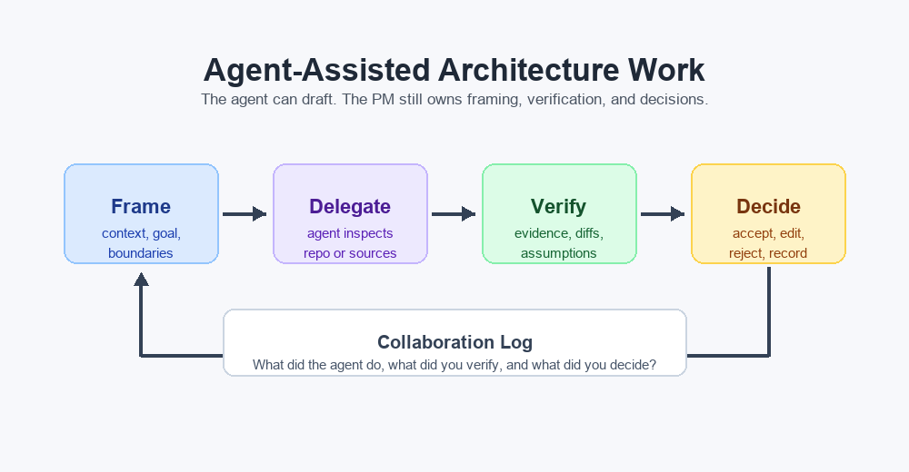

# Claude Code Prototyping

Claude Code changes the PM workflow. Instead of manually building every screen,
API, and data model, you ask Claude Code to produce the working version. Your
job becomes sharper: define the outcome, constrain the work, test the result,
and decide what gets accepted.

For this activity, do not build the application by hand in an editor. Use Claude
Code for the implementation. Read the files it creates, run the prototype, and
ask for focused corrections when a test fails.



## The AI PM Loop

Use this loop whenever Claude Code works on the prototype:

1. **Frame:** explain the product context, the artifact needed, and the
   boundaries.
2. **Delegate:** ask Claude Code to inspect sources, propose a plan, or update
   files.
3. **Verify:** review evidence, run checks, compare with source files, and look
   for overclaims.
4. **Decide:** accept, edit, reject, or ask for another pass.
5. **Record:** note what changed and why.

## A Small Product, Two Architectures

The practical challenge uses one deliberately small product: a room-booking
tool for a shared office. A participant can browse rooms, reserve a time slot,
see a conflict, and receive a confirmation. It is small enough to prototype in
one session, but it still creates meaningful architectural questions.

Both versions must deliver the same user journey:

| Monolith | Multi-service system |
|---|---|
| One web application contains the interface, booking logic, persistence, and confirmation behavior. | A frontend talks to a booking API; a separate notification component reacts after a booking. Each service has one clear responsibility. |
| One local data store holds rooms, bookings, and confirmation records. | The booking API owns booking data; the notification API owns its confirmation records and must not write directly to booking data. |
| One process is usually enough to run locally. | Multiple local processes or containers may be needed, plus a clear contract between them. |

The multi-service version does not need production infrastructure, authentication,
an actual email provider, or a message broker. A local HTTP call or simple local
event mechanism is sufficient for demonstrating the boundary.

## Example: Give Claude Code a Bounded Build Request

Prompt:

```text
Create a small room-booking prototype in this repository. Do not commit or push.

The required user journey is:
1. View rooms and available time slots.
2. Create a booking with a name, room, date, and time.
3. Reject a conflicting booking clearly.
4. Persist the confirmed booking after browser refresh.
5. Show a confirmation after booking.

First inspect the repository and propose:
- a minimal stack and file structure
- file structure
- how to run it locally
- acceptance tests
- architecture risks

Wait for my approval before creating files.
```

After approval, ask Claude Code for a small, verifiable change set. The same brief and
acceptance criteria must be used for both variants. Otherwise the comparison is
not fair. You do not need to know how to implement a web framework yourself:
ask Claude Code to explain which files are the frontend, API, and database layer
before you run the prototype.

## What Agents Are Good At

Claude Code is useful for:

- proposing a minimal stack and file structure
- generating the first implementation from an approved brief
- explaining component responsibilities and API contracts
- drafting tests and run instructions
- identifying missing error cases and architecture risks
- documenting the differences between the two variants

Claude Code is weaker at:

- knowing private business constraints
- validating undocumented team ownership
- judging user impact without product context
- distinguishing current architecture from old docs
- making final trade-off decisions

## Verification Checklist

Before accepting a Claude Code-produced architecture artifact, check:

- Does every major claim cite a file path, source URL, or explicit assumption?
- Did Claude Code inspect the actual repository, or only infer from names?
- Are unknowns clearly marked?
- Are risks translated into PM-relevant questions?
- Did Claude Code avoid changing files before approval?
- If files changed, are the diffs small, readable, and aligned with the request?
- Are generated docs still useful to humans, or just a large summary?

## Activity: Run the First Prototype Review

Before accepting the monolith, ask Claude Code to explain what it built and how
to test it. Run the application yourself and execute the five acceptance
criteria from [templates/prototype-brief.md](templates/prototype-brief.md).

Then complete this short review:

| Review question | Your notes |
|---|---|
| Does the browser flow work from start to finish? | |
| Is booking data still present after refresh? | |
| Is a conflict handled clearly? | |
| Which component owns the booking rule? | |
| What would break first with ten times more traffic? | |

## Check Your Understanding

What changes when Claude Code writes most of the prototype?

<details>
<summary>Show answer</summary>

The PM role shifts from producing every line manually to defining the outcome,
choosing constraints, verifying the product behavior, and making decisions.
Accountability does not disappear. It becomes more focused on judgment, review,
and product context.

</details>
