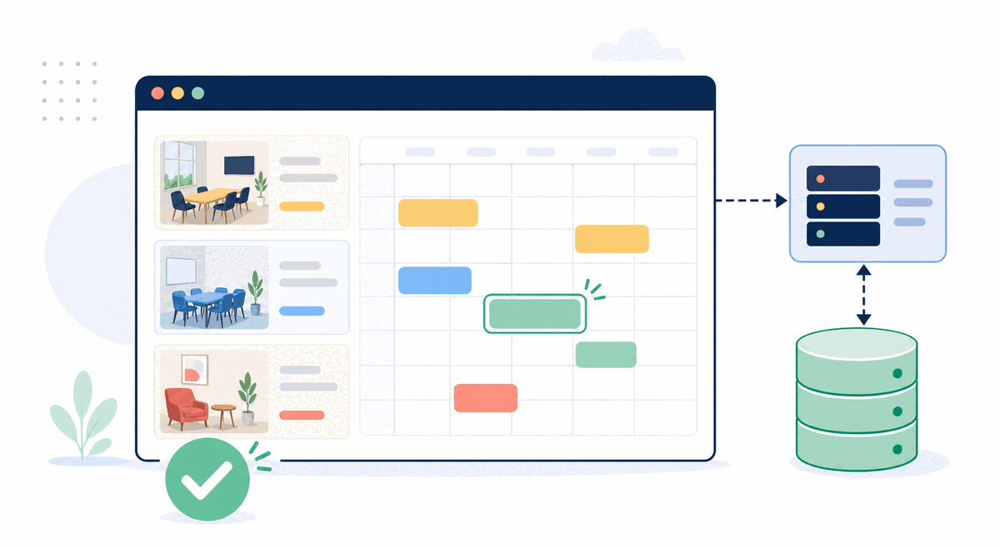

# Prototype Brief and Acceptance Criteria

Before Claude Code builds anything, you need a small product brief. This
is not a technical specification for engineers. It is a shared contract: what
must work, what is out of scope, and how the group will decide whether the
prototype works.

## The Product: Room Booking

The workshop uses a small room-booking tool for a shared office. It is simple
enough for Claude Code to create quickly, while still showing the three building
blocks of many web applications:



*The browser presents rooms and bookings; the API applies product rules; the
database preserves confirmed bookings.*

```text
Browser interface -> API -> Database
```

- The **browser interface** lets a person browse rooms and submit a booking.
- The **API** receives the request, applies the booking rules, and returns a
  clear result to the browser.
- The **database** stores rooms and confirmed bookings so they remain after a
  browser refresh.

You are not expected to build an API or database manually. Ask Claude Code to
create them, then inspect the files and test their behavior.

## Complete the Brief

Use [templates/prototype-brief.md](templates/prototype-brief.md). Keep the
scope deliberately narrow:

1. Browse rooms and available slots.
2. Create a booking with a name, room, date, and time.
3. Reject a conflicting booking with a clear message.
4. Keep a confirmed booking after browser refresh.
5. Show a confirmation after a successful booking.

Do not add sign-in, external calendars, email delivery, payments, cloud
deployment, or a design system. Those are real product decisions, but they
would make the architecture comparison harder to see.

## Ask Claude Code for a Plan First

Paste the completed brief, then use this prompt:

```text
Create a plan for our room-booking prototype before writing files.

Explain in simple language:
- which files create the browser interface
- which files create the API
- which files create or access the database
- how to run the prototype locally
- how you will test the five acceptance criteria

Keep dependencies minimal. The session handout recommends a lightweight stack
for this particular exercise, while allowing a justified alternative. Wait for
approval before creating files.
```

Review the response together. Your job is not to judge every line of code. Your
job is to ensure the plan is small, understandable, and aligned with the brief.

## Review the Build Plan

| Question | Notes |
|---|---|
| Can we point to a frontend, API, and database? | |
| Does the plan implement all five acceptance criteria? | |
| Does it avoid the deliberately excluded features? | |
| Can we run it locally without cloud accounts? | |
| Does it explain where the conflict rule is enforced? | |
| Does it explain what data persists after refresh? | |

## Check Your Understanding

Why use the same brief for both prototypes?

<details>
<summary>Show answer</summary>

Without a shared brief and acceptance criteria, the group may be comparing two
different products instead of two architectures. The shared contract makes the
differences in data flow, delivery effort, and failure modes visible.

</details>
