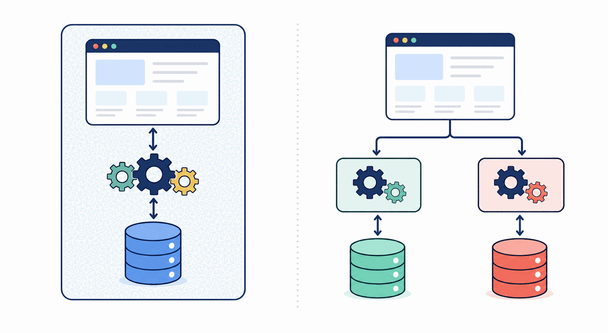
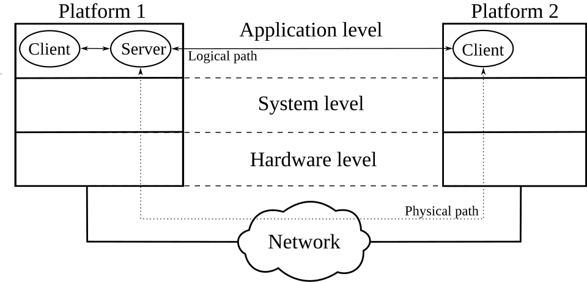
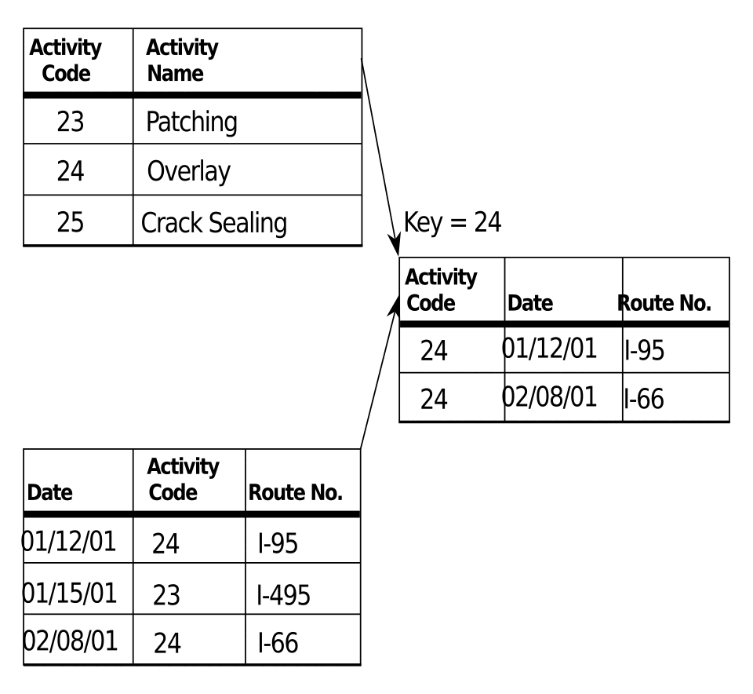

# APIs, Databases, and Multi-Service Systems

This module introduces two ideas through the prototypes rather than through a
framework tutorial: an API and a database. Different products can use different
technologies; focus first on the responsibilities and boundaries.



*One application can keep responsibilities close together; separate services
make boundaries and data ownership more explicit.*

## API: The Conversation Between Components

An API is a structured way for one component to ask another component for work
or information. In the room-booking prototype, the browser should not write
directly into the database. It asks the booking API to do it.



*Client-server model. Source: [Michel Bakni, Wikimedia
Commons](https://commons.wikimedia.org/wiki/File:Client-Server_Model-en.svg),
[CC BY-SA 4.0](https://creativecommons.org/licenses/by-sa/4.0/).*

```text
Browser -> create booking request -> Booking API -> Database
Browser <- confirmation or conflict <- Booking API <- Database
```

Whether the local server is FastAPI or another framework, what matters is the
responsibility:

- the browser collects and displays information;
- the API checks the booking rule;
- the database persists the rooms and bookings.

## Database: The Product's Memory

A database keeps information after one request or browser session ends. For the
prototype, it needs only a few concepts:

| Data | Why it exists |
|---|---|
| Room | Lets the browser show what can be booked. |
| Booking | Records who reserved which room and time. |
| Date and time | Lets the API identify a conflict. |
| Booking status | Lets the interface show confirmation or rejection. |

Ask Claude Code to point to the database file or schema. Then make a booking,
refresh the browser, and confirm that the data is still there. That observation
is more important than learning database syntax today.



*Relational model. Source: [U.S. Department of Transportation via Wikimedia
Commons](https://commons.wikimedia.org/wiki/File:Relational_Model.svg), public
domain.*

## Start With a Monolith

In the monolith prototype, the interface, API, and database access are part of
one application. They may be in separate files, but one local application owns
the whole flow.

```text
One application
  -> browser interface
  -> booking API and conflict rule
  -> booking database
  -> confirmation
```

This is often a sensible first architecture because it is quick to build, easy
to run locally, and easy for a small team to understand.

## Compare With a Multi-Service Version

The second prototype keeps the same browser, API, and database responsibilities,
but separates the confirmation behavior into its own component.

```text
Browser -> Booking API -> Booking database
                    |
                    -> Notification service -> confirmation feed
```

The booking API still owns the conflict rule and booking data. The notification
service receives only the information it needs after a successful booking. It
can store a confirmation record in its own data store. A local HTTP request or
simple local event is enough; no cloud queue or email provider is needed.

```text
Booking API -> booking data store
Notification API -> notification data store
```

The notification API never reads or writes the booking data store directly. Its
API or event payload is the only way it learns about a confirmed booking.

This introduces a useful trade-off:

| Question | Monolith | Multi-service version |
|---|---|---|
| How many applications must run? | Usually one. | More than one. |
| Where does the booking rule live? | In the same application. | In the booking API. |
| How is confirmation triggered? | Internal application logic. | A request or event sent to another component. |
| What new failure can occur? | A failure affects the whole application. | The booking may work while notification is unavailable. |
| What becomes easier later? | Simple changes stay local. | Notification work can evolve separately. |

## Activity: Trace One Booking

Run both prototypes and trace one successful booking.

| Step | Monolith evidence | Multi-service evidence |
|---|---|---|
| The browser sends booking details | | |
| The API validates the request | | |
| The database stores the booking | | |
| The browser receives a confirmation | | |
| The notification component receives the booking | Not applicable | |

Then try the same room and time again. Record where the conflict is detected.

## Check Your Understanding

Why does the browser use an API instead of writing directly to the database?

<details>
<summary>Show answer</summary>

The API is the controlled place for product rules, such as rejecting a duplicate
booking. It can validate inputs, decide what data may be read or written, and
return a clear response to the browser. That separation also makes it possible
to change the interface without giving it direct control over stored data.

</details>
