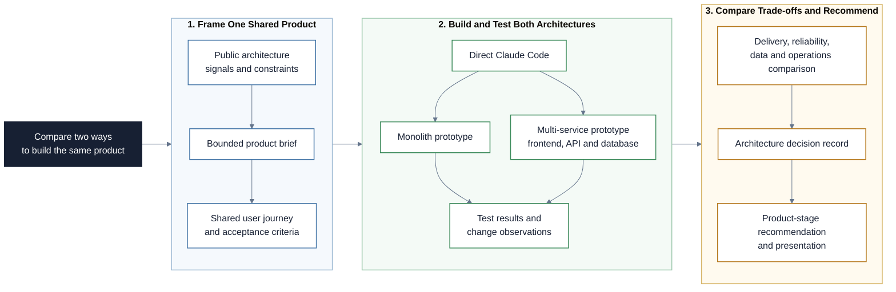

# Software Architecture Fundamentals

This repository is a Markdown-based learning path for AI Product Managers who
need to understand software architecture well enough to ask better questions,
spot trade-offs, and steer AI coding agents responsibly. Participants first
reverse-engineer a real company's public architecture signals. They then use
Claude Code to prototype the same small product in two forms: a monolith and a
distributed, multi-service system. Their job is to define the brief, direct the
work, test both prototypes, compare the trade-offs, and make a product
recommendation. Claude Code writes the implementation; participants steer,
inspect, and validate it.

## Project at a Glance

The project uses one product brief to build and compare two architectures, then
turns the observed trade-offs into a product-stage recommendation.

## Learning Objectives

By the end of this repository, you should be able to:

- Explain architecture as a set of product and engineering trade-offs.
- Identify common architecture styles such as layered systems, monoliths,
  modular monoliths, microservices, event-driven systems, and serverless
  systems.
- Infer a public company's tech stack and architecture from engineering blogs,
  documentation, repositories, and job posts.
- Map a simple user journey into components, data flow, storage, observability,
  and reliability concerns.
- Translate architecture observations into PM implications: delivery speed,
  dependencies, risks, technical debt, analytics readiness, and AI readiness.
- Use Claude Code to turn one product brief into a small, testable prototype.
- Compare a monolith with a distributed, multi-service architecture using the
  same user journey and acceptance criteria.
- Review generated code, run the prototypes, and identify where the architecture
  creates delivery, reliability, data, or operational trade-offs.
- Extend both prototypes with additional features once the shared core is
  complete, and observe how each architecture responds to change.
- Record an architecture recommendation in an ADR and explain it to a
  non-technical stakeholder.

## Learning Path

The modules build on each other in order.

| File / Folder | Description |
|---|---|
| [**01 - Architecture Foundations**](01-architecture-foundations.md) | Learn the vocabulary PMs need for systems, components, data flow, non-functional requirements, and trade-offs. |
| [**02 - Reverse-Engineer Public Architecture**](02-reverse-engineer-public-architecture.md) | Research a real company's public engineering signals and infer its architecture responsibly. |
| [**03 - Claude Code Prototyping**](03-agent-assisted-architecture-work.md) | Use Claude Code to turn a bounded product brief into a testable prototype while retaining PM control. |
| [**04 - Prototype Brief and Acceptance Criteria**](04-prototype-brief-and-acceptance-criteria.md) | Turn a product idea into a small, testable build request for Claude Code. |
| [**05 - APIs, Databases, and Multi-Service Systems**](05-apis-databases-and-multi-service-systems.md) | Discover the role of an API and a database while comparing two ways to build the same product. |
| [**06 - Session Handout**](06-session-handout.md) | Run the extended workshop and produce two prototypes, an architecture comparison, and an ADR. |
| [**07 - Final Review and Presentation**](07-final-review-and-presentation.md) | Test both prototypes, present the evidence, make a product-stage recommendation, and optionally present an extension. |

### Additional Folders and Files

| File / Folder | Description |
|---|---|
| [**assets**](assets/) | Local illustrations used by the modules and session handout. |
| [**templates**](templates/) | Reusable templates for product briefs, architecture notes, and ADRs. |

## Getting Started

No Python environment is required for this repository.

1. Open `README.md`.
2. Follow the lesson files in numerical order.
3. Use the templates when the workshop asks for a deliverable.
4. Use Claude Code to create each prototype. Do not build it manually; instead,
   steer Claude Code with a clear brief and test the result against the shared
   acceptance criteria.

## References & Further Reading

- [Syndicode: How to Choose a Tech Stack](https://syndicode.com/blog/how-to-choose-tech-stack/):
  Practical framing for choosing technology based on product, team, and
  business constraints.
- [Microsoft Azure Architecture Center: Architecture styles](https://learn.microsoft.com/en-us/azure/architecture/guide/architecture-styles/):
  Overview of common architecture styles and their trade-offs.
- [AWS Well-Architected Framework](https://docs.aws.amazon.com/wellarchitected/latest/framework/welcome.html):
  Cloud architecture framework covering operational excellence, security,
  reliability, performance, cost, and sustainability.
- [Architecture Decision Records project](https://github.com/architecture-decision-record/architecture-decision-record):
  Practical explanation of ADRs as lightweight records of architectural choices,
  context, and consequences.
- [Anthropic Claude Code: Overview](https://docs.anthropic.com/en/docs/claude-code/overview):
  Official overview of Claude Code as an agentic coding tool.
- [FastAPI: First Steps](https://fastapi.tiangolo.com/tutorial/first-steps/):
  Official introduction to API routes and automatic interactive API docs.
- [FastAPI: Static Files](https://fastapi.tiangolo.com/tutorial/static-files/):
  Official guide to serving a small static frontend from a FastAPI application.
- [Python `sqlite3`](https://docs.python.org/3/library/sqlite3.html):
  Official documentation for Python's lightweight, disk-based SQLite interface.
